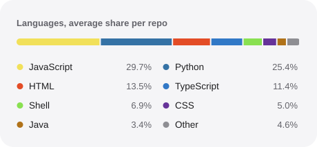
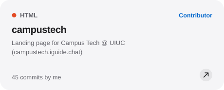

<!-- headline:start -->

<a href="https://www.linkedin.com/in/michaelleeee2/" title="LinkedIn"><picture><source media="(prefers-color-scheme: dark)" srcset="assets/masthead-dark.svg"></picture></a>

<!-- headline:end -->

### About

- **Quant research × ML.** NLP on market text: LLM-assisted labelling, BERT classifiers, turning noisy posts into structured signals.
- **Creative web.** Collecting and remixing interactive effects, building Three.js toys.
- **Games.** Multiplayer netcode for a colony-sim mod, and solvers that play puzzle games for me.
- **Small, sharp tools.** Dashboards, pipelines and automations that do one job well.

### Stack

  <picture>
    <source media="(prefers-color-scheme: dark)" srcset="https://skillicons.dev/icons?i=py%2Cpytorch%2Cjs%2Cts%2Creact%2Cvue%2Cthreejs%2Cvite%2Cflask%2Cnodejs%2Ccs%2Ccloudflare%2Csupabase%2Cdocker%2Cgit%2Chtml%2Ccss%2Cbash&perline=9&theme=dark">
    
  </picture>

### Activity

  <picture>
    <source media="(prefers-color-scheme: dark)" srcset="assets/figures-dark.svg">
    
  </picture>
  <picture>
    <source media="(prefers-color-scheme: dark)" srcset="assets/languages-dark.svg">
    
  </picture>

  <picture>
    <source media="(prefers-color-scheme: dark)" srcset="assets/skyline-dark.svg">
    
  </picture>

### Projects

The repositories I have committed to the most.

<!-- projects:start -->

  <a href="https://github.com/a2751012962/caaciorg" title="a2751012962/caaciorg, 421 commits by me"><picture><source media="(prefers-color-scheme: dark)" srcset="assets/card-a2751012962-caaciorg-dark.svg"></picture></a>
  <a href="https://github.com/IGUIDE-chat/campustech" title="IGUIDE-chat/campustech, 38 commits by me"><picture><source media="(prefers-color-scheme: dark)" srcset="assets/card-iguide-chat-campustech-dark.svg"></picture></a>
  <a href="https://github.com/IGUIDE-chat/iGuide" title="IGUIDE-chat/iGuide, 31 commits by me"><picture><source media="(prefers-color-scheme: dark)" srcset="assets/card-iguide-chat-iguide-dark.svg"></picture></a>
  <a href="https://github.com/Lyraedan/Oxygen_Not_Included_Together" title="Lyraedan/Oxygen_Not_Included_Together, 23 commits by me"><picture><source media="(prefers-color-scheme: dark)" srcset="assets/card-lyraedan-oxygen-not-included-together-dark.svg"></picture></a>
  <picture><source media="(prefers-color-scheme: dark)" srcset="assets/card-iguide-chat-muse-gateway-dark.svg"></picture>

<!-- projects:end -->
